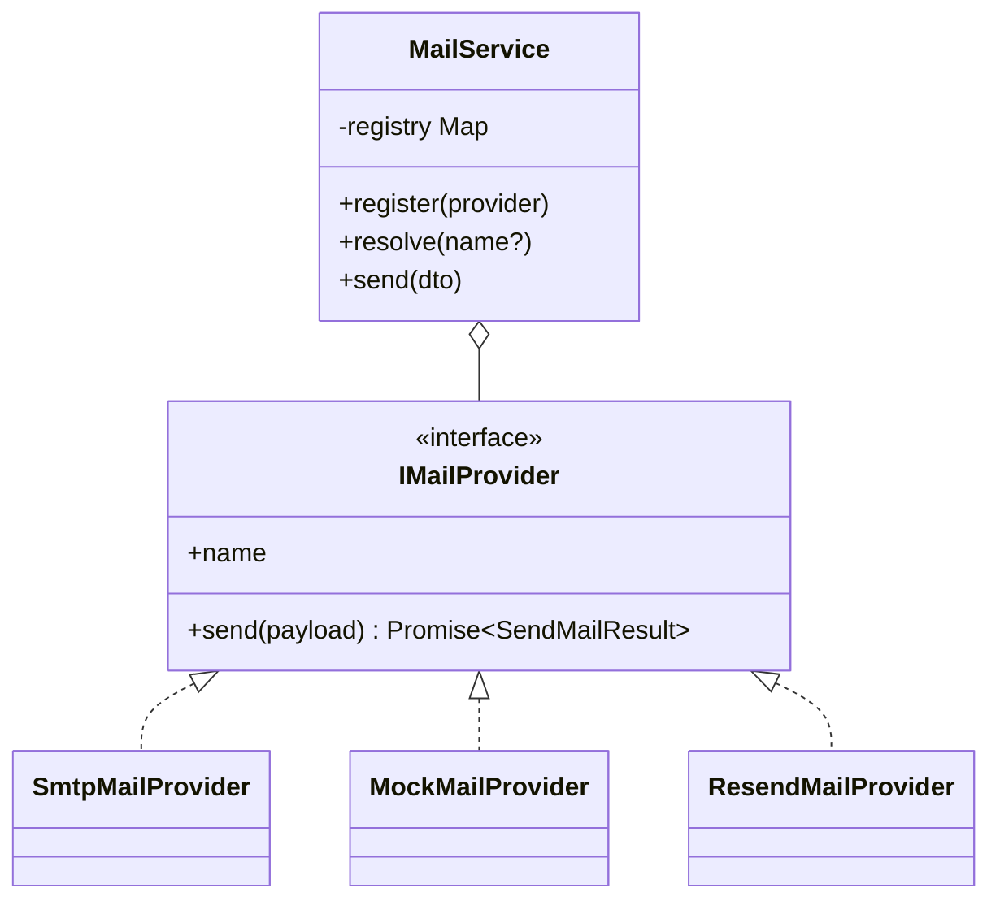

# Mail Module – NestJS

Module gửi email thông báo, áp dụng **Strategy Pattern** và **Adapter Pattern** để hỗ trợ nhiều provider (SMTP/Nodemailer, Resend, Mock) mà không dùng `switch/case`.

## Kiến trúc



- **Strategy (`IMailProvider`)**: hợp đồng chung, mỗi provider là một chiến lược gửi mail.
- **Adapter**: mỗi provider bọc một thư viện/API khác nhau (nodemailer, HTTP API của Resend, console log) về cùng một interface.
- **Registry (`MailService`)**: giữ `Map<string, IMailProvider>`, chọn provider theo tên trong request, nếu không truyền thì dùng `MAIL_DEFAULT_PROVIDER`.

## Cấu trúc thư mục

```
src/mail/
├── dto/send-mail.dto.ts
├── enums/mail-provider.enum.ts
├── interfaces/mail-provider.interface.ts
├── providers/
│   ├── smtp-mail.provider.ts
│   ├── mock-mail.provider.ts
│   └── resend-mail.provider.ts
├── utils/is-html.util.ts
├── mail.constants.ts
├── mail.service.ts
├── mail.controller.ts
└── mail.module.ts
```

## Cài đặt

Yêu cầu Node.js 18 trở lên.

```bash
npm install
cp .env.example .env   # Windows PowerShell: Copy-Item .env.example .env
npm run start:dev
```

Server chạy tại `http://localhost:3000`.

## Biến môi trường

| Biến | Bắt buộc | Mô tả |
|---|---|---|
| `MAIL_DEFAULT_PROVIDER` | Không | Provider mặc định: `smtp`, `mock` hoặc `resend` (mặc định `mock`) |
| `SMTP_HOST`, `SMTP_PORT` | Khi dùng `smtp` | Máy chủ SMTP (ví dụ `smtp.ethereal.email`, `587`) |
| `SMTP_USER`, `SMTP_PASS` | Khi dùng `smtp` | Tài khoản SMTP |
| `MAIL_FROM` | Không | Địa chỉ gửi cho SMTP |
| `RESEND_API_KEY` | Khi dùng `resend` | API key của Resend |
| `RESEND_FROM` | Không | Địa chỉ gửi cho Resend (mặc định `onboarding@resend.dev`) |
| `PORT` | Không | Cổng chạy server (mặc định `3000`) |

Tài khoản SMTP test miễn phí: [Ethereal Email](https://ethereal.email/). Mail không gửi thật, chỉ xem được qua `previewUrl` trong response.

## API

### `POST /api/v1/mail/send`

| Trường | Kiểu | Bắt buộc | Mô tả |
|---|---|---|---|
| `to` | string | Có | Email người nhận, đúng định dạng email |
| `subject` | string | Có | Tiêu đề thư |
| `content` | string | Có | Nội dung (text hoặc HTML) |
| `provider` | `smtp` \| `mock` \| `resend` | Không | Bỏ trống thì dùng `MAIL_DEFAULT_PROVIDER` |

**Thành công – HTTP 200**

```json
{
  "message": "Email sent successfully",
  "provider": "smtp",
  "messageId": "<abc@ethereal.email>",
  "previewUrl": "https://ethereal.email/message/..."
}
```

**Lỗi validation – HTTP 400**

Request: `{ "to": "invalid-email-format", "subject": "" }`

```json
{
  "message": [
    "to must be an email",
    "subject should not be empty",
    "content should not be empty",
    "content must be a string"
  ],
  "error": "Bad Request",
  "statusCode": 400
}
```

**Provider không hợp lệ – HTTP 400**

```json
{
  "message": ["provider must be one of the following values: smtp, mock, resend"],
  "error": "Bad Request",
  "statusCode": 400
}
```

**Provider gửi thất bại – HTTP 502**

```json
{ "message": "Failed to send email via smtp", "error": "Bad Gateway", "statusCode": 502 }
```

Các request mẫu nằm trong `requests.http` (dùng extension REST Client của VS Code).

## Thêm provider mới

1. Thêm giá trị vào `MailProviderName` (ví dụ `SENDGRID = 'sendgrid'`).
2. Tạo `SendGridMailProvider implements IMailProvider` trong `providers/`.
3. Khai báo nó trong `providers` và trong `useFactory` / `inject` của `mail.module.ts`.

`MailService` không phải sửa.

## Kiểm thử

```bash
npm test          # unit test
npm run build     # kiểm tra biên dịch
npm run lint
```

- `mail.service.spec.ts`: chọn provider theo tên, dùng provider mặc định, báo lỗi khi provider không tồn tại, bọc lỗi gửi thất bại thành 502, đăng ký provider lúc runtime.
- `send-mail.dto.spec.ts`: validate `to`, `subject`, `content`, `provider`.